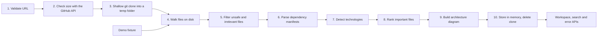

# Codex Navigator Lite

**Understand an unfamiliar public GitHub repository without running its code.**

Paste a public GitHub URL and Codex Navigator Lite clones a safe snapshot, reads its files as plain text, and builds a guide to the project:

- **What it is:** languages, frameworks, package managers, test tools, databases, authentication, deployment and CI.
- **What it depends on:** runtime and development dependencies read from the project's manifest files.
- **How it is laid out:** the important files (entry points, config, routes, API, services, database, tests), a file tree, and an architecture diagram.
- **Where things are:** search with plain-English questions, or paste an error message to find the files most likely involved.

Built for the OpenAI hackathon. All analysis is rule-based TypeScript running on your own machine. No AI model is called at runtime, nothing is sent to an external service, and the imported repository's code is never executed.

---

## Quick start

You need **Node.js 20 or newer**, **npm**, and **Git** on your `PATH`.

```sh
git clone https://github.com/AmeerHamza73537/Codex-Navigator.git
cd Codex-Navigator
npm ci
npm run dev
```

Open <http://localhost:3000>, then either:

- paste a public repository URL such as `https://github.com/sindresorhus/ky` and press **Analyze**, or
- press **Try Demo Repository** to analyze the bundled sample project. This needs no network access.

No `.env` file, API key or account is required. For a more stable demo, run the production build instead:

```sh
npm run build
npm start
```

### Commands

| Command | What it does |
| --- | --- |
| `npm run dev` | Starts the development server on port 3000. |
| `npm run build` / `npm start` | Builds and serves the production version. |
| `npm test` | Runs the Vitest test suite. |
| `npm run lint` | Runs ESLint. |
| `npm run typecheck` | Runs the TypeScript compiler in check-only mode. |

---

## Using the workspace

After an import, the workspace has five tabs:

| Tab | Shows |
| --- | --- |
| **Overview** | A one-line project summary, the detected stack with the evidence for each item, package scripts, and the runtime and development dependency lists. |
| **Architecture** | A Mermaid diagram of the detected components, such as frontend, routes, API, services, auth, database, tests and CI, with a plain-language explanation. |
| **Important Files** | Ranked files grouped by purpose. Each shows why it was picked and can be expanded to its first 120 lines. |
| **Repository Search** | Answers questions like *"Where is authentication implemented?"* with ranked files, reasons and line-numbered excerpts. |
| **Error Investigator** | Takes a pasted stack trace or error, extracts its signals, and ranks the files most likely related to it. |

---

## Tech stack

| Layer | Technology |
| --- | --- |
| Framework | Next.js 15 (App Router): the pages and the API route handlers in one app |
| Language | TypeScript (strict mode) |
| UI | React 19, Tailwind CSS 4 |
| Diagrams | Mermaid, rendered in the browser in strict security mode |
| Tests | Vitest |
| Runtime services | Node.js `fs` and `child_process` (to run `git`), the built-in `fetch`, and an in-memory store |

There is no database, login system, queue, vector store or external AI API.

---

## How it works

Every repository passes through the same pipeline. The bundled demo enters it at step 4, with files from a fixture instead of a clone.



The code for steps 1 to 5 and step 10 is in `src/import/repository-importer.ts`. Each analysis step is a pure function in `src/analysis/`.

### 1. Validate the URL (`src/import/github-url.ts`)

Only `https://github.com/<owner>/<repository>` is accepted, with or without a trailing `.git`. The validator rejects other hosts, `http`, ports, embedded credentials, query strings, fragments, extra path segments, and invalid owner or repository names. It then builds a clean clone URL from the parsed owner and name rather than reusing the user's input.

### 2. Check the size before downloading

An unauthenticated request to `https://api.github.com/repos/<owner>/<repository>` reads the `size` field. Repositories over 100 MB are rejected before anything is downloaded. A 404 response becomes a "repository not found" error. Renamed or transferred repositories are followed through GitHub's redirect.

### 3. Clone safely

`git` is started with an argument array and `shell: false`, so the URL is never interpreted by a shell:

```text
git -c core.hooksPath=<empty folder> -c credential.helper= \
    clone --depth 1 --single-branch --no-tags --no-recurse-submodules <url> <temp folder>
```

The child process also gets a cleaned environment. Inherited `GIT_*` variables are removed, the global Git config is replaced with an empty file, the system config is disabled, password prompts are turned off and Git LFS downloads are skipped. As a result, hooks, credentials, submodules and large binary files are never involved.

The clone stops after 60 seconds, and only one import runs at a time. Clone failures are turned into readable errors: "private repository", "not found", "timed out", or "Git is not installed".

### 4. Walk the files on disk

The importer walks the checkout recursively and records each file's path and size. While walking it:

- skips symbolic links and Windows reparse points, so nothing outside the clone can be reached;
- skips the `.git` folder;
- stops with "repository too large" if the checkout exceeds 20,000 files or 100 MB;
- reads only the **first 8 KB** of each file to sniff for binary content. A file counts as binary if it contains a NUL byte or if more than 10% of the sampled bytes are control characters.

Full file contents are read only after a file passes the filter in step 5.

### 5. Filter (`src/analysis/file-filter.ts`)

Each file passes through these checks in order. The first one that fails excludes the file and is recorded as a warning reason.

1. **Path safety:** absolute paths, drive letters, NUL bytes and `..` segments are rejected.
2. **Ignored folders:** `node_modules`, `.next`, `dist`, `build`, `coverage`, `vendor`, `target`, `venv`/`.venv`, `__pycache__`, `Pods`, `DerivedData`, and any `*cache` folder.
3. **Secret file names:** `.env` and `.env.*` (but `.env.example` is kept), `.npmrc`, `.netrc`, `id_rsa`, `credentials*`, `secrets*`, `*.pem`, `*.key`, `*.p12`, `*.tfstate`, and similar.
4. **Binary extensions:** images, audio, video, archives, executables, fonts and database files.
5. **Binary content:** the result of the sniff in step 4.
6. **Size limits:** more than 512 KB per file, more than 10,000 indexed files, or more than 50 MB of indexed text.
7. **Secret content:** after reading, files containing private-key headers or well-known token formats (GitHub, AWS, Google, Stripe live, Slack) are dropped.

What remains is a list of `{ path, content }` text files. Everything else in the analysis is built from that list.

### 6. Parse dependency manifests (`src/analysis/technology-detector.ts`)

Each known manifest is parsed with a small format-specific reader. No package manager is ever run. Every dependency is recorded as `{ name, sourcePath, dev }`.

| Manifest | What is read | Counted as dev |
| --- | --- | --- |
| `package.json`, `composer.json` | `dependencies`, `devDependencies`, `peerDependencies`, `optionalDependencies`, `require`, `require-dev` | `devDependencies`, `require-dev` |
| `requirements.txt`, `requirements-dev.txt` | One requirement per line; comments, versions and extras are stripped | the `-dev` file |
| `pyproject.toml` | PEP 621 `[project] dependencies = [...]`, `[project.optional-dependencies]`, `[dependency-groups]`, and Poetry `[tool.poetry.*dependencies]` tables (the `python` key is skipped) | optional, group and Poetry dev/group tables |
| `Pipfile` | `[packages]`, `[dev-packages]` | `[dev-packages]` |
| `Cargo.toml` | `[dependencies]`, `[build-dependencies]`, `[dev-dependencies]` | `[dev-dependencies]` |
| `Gemfile` | `gem "name"` lines | none |
| `pom.xml`, `*.gradle`, `*.gradle.kts` | `<artifactId>` and `group:artifact:version` strings | none |
| `*.csproj` | `<PackageReference Include="...">` | none |

Each package is listed once per manifest. If it appears as both runtime and dev, the runtime entry wins.

**Why runtime and dev are separated:** frameworks, databases and auth libraries are detected **only from runtime dependencies**. A library that installs Express just to run its tests is therefore not reported as "an Express app". Test tools are detected from both.

### 7. Detect technologies

Detection is a set of plain rule tables in `technology-detector.ts`. A rule can match on:

- **a dependency name**, for example `next` → Next.js or `fastapi` → FastAPI;
- **an exact file name**, for example `pnpm-lock.yaml` → pnpm, `Dockerfile` → Docker, `uv.lock` → uv;
- **a path pattern**, for example `.github/workflows/*.yml` → GitHub Actions or `src/main.rs` → Rust entry point;
- **a content pattern**, for example `import SwiftUI` or `from django.db`.

Languages come from file extensions. Package scripts are read from every `package.json`. Every detection carries up to five pieces of **evidence**, each a file path and the reason it matched, and the UI shows them.

The supported categories are languages, frameworks, package managers, test tools, database/ORM, authentication, deployment, CI, entry points and package scripts.

### 8. Rank important files (`src/analysis/important-file-detector.ts`)

Every file is scored against each category (entry point, routing, authentication, database, API, services, state management, configuration, environment example, test, CI, deployment, documentation):

| Signal | Points |
| --- | --- |
| Exact file name (`package.json`, `README.md`, `schema.prisma`, …) | 40 |
| Framework convention path (`app/api/**/route.ts`, `docs/*.md`, …) | 35 |
| Located in a matching folder (`auth/`, `services/`, `tests/`, …) | 18 |
| Exact file name **at the repository root** (bonus) | 15 |
| Imports a related library (`next-auth`, `@prisma/client`, `express`, …) | 16 |
| Defines a related symbol (`PrismaClient`, `urlpatterns`, `export function GET`, …) | 14 |
| Supports an already-detected technology (bonus) | 8 |

A file needs at least 18 points to be listed. The output keeps at most 4 files per category and 24 files in total, sorted by score. The root bonus keeps the project's own README and manifest above copies in `examples/` or `docs/`.

### 9. Build the architecture diagram (`src/analysis/architecture-diagram.ts`)

Component nodes (Frontend, Pages and Routes, API, Services, Authentication, Database, External Services, Tests, CI and Deployment) are created only when there is evidence: a detected technology, an important file in that category, or a matching file or content pattern. Fixed, conservative edges connect them, for example Frontend → Routes → API → Services → Database, and Tests → *verifies*. All labels are sanitized before they become Mermaid source.

If no component is found, the diagram falls back to the top-level folders. The diagram describes structure, not verified runtime call flow.

### 10. Store and clean up (`src/server/repository-store.ts`)

The finished analysis and the indexed file contents are stored **in memory** under a random UUID. The store keeps at most 5 analyses, for 6 hours each, and is cleared when the server restarts. The temporary clone is deleted in a `finally` block, and leftovers from a crash are swept up on the next import.

### Search (`src/search/repository-search.ts`)

1. The question is normalized (lowercased, camelCase split, punctuation removed) and stop words such as *where*, *is* and *the* are dropped.
2. Developer concepts are expanded with synonyms. For example, *auth* → authentication, login, session, token, middleware; *database* → db, prisma, schema, model.
3. Every indexed file is scored:

   | Signal | Points |
   | --- | --- |
   | The question contains the file's exact path | 80 |
   | File name matches a term | 34+ |
   | Important-file category matches the concept | 30+ |
   | Exported symbol matches | 26+ |
   | Path or folder matches | 24+ / 18+ |
   | Content matches (original / expanded terms) | up to 30 / 18 |
   | File is evidence for a detected technology | 10 |
   | Test file when the question is not about tests | −45 |

4. Files with at least 12 points are kept. The top 8 are returned, each with its reasons and up to two line-numbered excerpts around the matching lines. Confidence is **high** at 70 or more points, **medium** at 35 or more, and **low** otherwise.

### Error investigator (`src/search/error-investigator.ts`)

The pasted error is scanned with regular expressions for **file paths**, **symbols** (`SomethingError`, `at Function.name`), **package names** (`node_modules/<pkg>`, `Cannot find module '…'`), **ports** (`localhost:6379`) and **error codes** (`ECONNREFUSED`, `404`). These signals and the first lines of the error are passed to the search engine above. The results come with general guidance and a clear note that they are not a guaranteed root cause.

---

## API

All responses are JSON. Errors use the shape `{ "error": { "code": "...", "message": "..." } }`.

| Method and path | Body | Returns |
| --- | --- | --- |
| `POST /api/repositories` | `{ "url": "https://github.com/owner/repo" }` | `201` with the repository metadata and full analysis |
| `POST /api/repositories/demo` | none | `201` with the demo analysis |
| `GET /api/repositories/{id}` | none | The stored analysis |
| `GET /api/repositories/{id}/files?path=...` | none | The first 120 lines of an indexed file |
| `POST /api/repositories/{id}/search` | `{ "question": "..." }` | Ranked search results |
| `POST /api/repositories/{id}/errors` | `{ "error": "..." }` | Extracted signals and ranked files |

Import error codes and their HTTP statuses: `invalid-repository` (400), `private-repository` and `repository-not-found` (404), `clone-timeout` (408), `repository-too-large` (413), `import-in-progress` (429), `repository-metadata-unavailable` (503), and `git-unavailable`, `clone-failed` and `processing-failed` (422).

The response types are defined in `src/domain/repository-analysis.ts`.

---

## Project structure

```text
src/
  app/                      Next.js pages and API route handlers
    api/repositories/       import, demo, workspace, files, search, errors
    repositories/[id]/      workspace page
  components/               landing form, workspace shell and the five tab views
  import/
    github-url.ts           URL validation
    process-runner.ts       runs git without a shell, with a timeout and bounded output
    repository-importer.ts  size check, clone, file walk, filtering, cleanup
  analysis/
    file-filter.ts          path, folder, secret, binary and size rules
    technology-detector.ts  manifest parsing, dependencies, stack detection
    important-file-detector.ts  important-file scoring
    architecture-diagram.ts Mermaid generation
  search/                   repository search and error investigator
  server/repository-store.ts  in-memory store with expiry
  domain/                   shared response types
  demo/                     the bundled TaskFlow fixture (plain strings, never executed)
tests/                      Vitest tests and sample repositories under tests/fixtures/
```

## Default limits

| Limit | Value |
| --- | --- |
| Repository size reported by GitHub | 100 MB |
| Files in the checkout | 20,000 |
| Clone timeout | 60 s |
| Indexed files | 10,000 |
| Size of a single indexed file | 512 KB |
| Total indexed text | 50 MB |
| Stored analyses | 5, each kept for 6 hours |

These are set in `DEFAULT_REPOSITORY_IMPORT_LIMITS` in `src/import/repository-importer.ts` and in `src/server/repository-store.ts`.

---

## Demo walkthrough

1. Press **Try Demo Repository**.
2. **Overview:** Next.js, React, Auth.js/NextAuth, Prisma, Vitest and Docker, with the evidence for each, plus scripts and dependencies.
3. **Architecture:** the component map and its explanation.
4. **Important Files:** expand an auth, API or database file to see why it was picked.
5. **Repository Search:** try *"Where is authentication implemented?"* or *"Where is the database schema?"*
6. **Error Investigator:** paste

   ```text
   Error: connect ECONNREFUSED 127.0.0.1:6379
       at RedisConnector (src/config/redis.ts:4:12)
   ```

The timed script is in [docs/demo-script.md](docs/demo-script.md), and the submission summary is in [docs/submission.md](docs/submission.md).

---

## Security notes

- Imported code is treated as text. Nothing from the repository is executed, built, installed or tested.
- `git` runs without a shell, without hooks, credentials, global or system config, submodules, tags or LFS, and with a timeout.
- Symbolic links are never followed, and paths containing `..` are rejected.
- Secret files and well-known token formats are excluded. This is a safety net, not a complete secret scanner.
- Mermaid labels are sanitized and rendered in strict mode.
- Analyses live only in server memory and expire. Temporary clones are deleted.

This is a local hackathon prototype with no user accounts. Do not expose it as a public multi-user service.

## Known limitations

- Public GitHub repositories only. Imports depend on network access and GitHub's unauthenticated rate limit of 60 requests per hour.
- Detection covers only the tools in its rule tables. Unknown tools, such as the AVA test runner, are not reported.
- No package manager is reported for a JavaScript project without a lockfile.
- Gemfile, Gradle, Maven and .NET dependencies are all listed as runtime; their test-only sections are not separated.
- Search is keyword- and rule-based, not semantic.
- Architecture edges are structural guesses, not traced calls.
- Analyses are lost when the server restarts. In `npm run dev`, restart the server after changing analysis code, because the store keeps the importer it was created with.
- Excluded files (binary, generated, oversized, dependency folders) are not searchable. Skip counts are returned as `warnings` in the API but are not yet shown in the UI.

## Roadmap

- Show skipped-file warnings in the workspace.
- Add rules for more ecosystems, each with fixture-based tests.
- Separate test-scoped dependencies for Gradle, Maven and Bundler.
- Export an offline analysis report.

## How Codex was used during development

Codex was a development collaborator, not a runtime dependency. It helped review the project against the hackathon requirements, trace the import and filesystem trust boundaries, implement and test the credential-isolated clone, limits and cleanup, build the TaskFlow demo fixture, write regression tests, and prepare this documentation. Codex is never called when a user imports, searches or investigates a repository.
