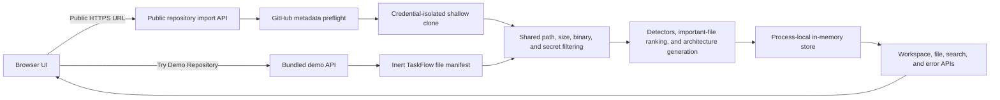

# Codex Navigator Lite

**Understand an unfamiliar public GitHub repository without running its code.**

Codex Navigator Lite is a local-first hackathon prototype that imports a public GitHub repository, filters it through a conservative safety boundary, and builds a deterministic repository guide. It highlights the stack, entry points, important files, likely architecture, relevant source excerpts, and files related to a question or pasted error.

The product does **not** call an AI model at runtime. Search, ranking, detection, diagrams, and error investigation are implemented with transparent TypeScript rules and lexical matching.

## Quick demo

```sh
npm ci
npm run dev
```

Open [http://localhost:3000](http://localhost:3000) and select **Try Demo Repository**. The bundled TaskFlow fixture is analyzed locally, needs no GitHub connection, and normally produces a complete workspace in well under a second after the server is ready.

For a scripted walkthrough, see [docs/demo-script.md](docs/demo-script.md). For the submission overview, see [docs/submission.md](docs/submission.md).

## Screenshots

> **Screenshot placeholder — Landing page:** Capture the public-repository URL field and the clearly labelled **Try Demo Repository** panel.

> **Screenshot placeholder — Analysis workspace:** Capture the Overview tab with TaskFlow stack detections and evidence.

> **Screenshot placeholder — Search and architecture:** Capture either the architecture diagram or the Redis connection-error search results.

No screenshot files are included yet; these placeholders intentionally do not reference nonexistent assets.

## Project overview

Repository onboarding is often slow because the useful signals are scattered across manifests, configuration, source folders, tests, deployment files, and naming conventions. A developer may spend the first part of a task locating authentication, tracing request paths, finding the database schema, or deciding which files are relevant to an error.

Codex Navigator Lite turns a safe snapshot into an evidence-backed navigation aid:

1. Accept a validated public `github.com` HTTPS repository URL, or use the bundled demo.
2. Filter unsafe, generated, binary, oversized, dependency, and likely secret material.
3. Detect technologies and important files from paths, manifests, imports, and source patterns.
4. Generate a conservative Mermaid architecture view.
5. Rank repository files for natural-language questions and error signals.
6. Show the evidence and bounded excerpts behind each result.

## Problem statement

Developers need a fast way to answer questions such as:

- What kind of project is this?
- Where are the entry points and important configuration files?
- Where is authentication or database access implemented?
- Which files are most relevant to an API request or stack trace?
- What does the repository appear to contain without executing untrusted code?

Existing approaches can require manual browsing, execute project tooling, or hide conclusions behind opaque output. This prototype focuses on a small, inspectable workflow: static evidence, explicit confidence, and no execution of imported repository code.

## Implemented features

### Repository import and safety boundary

- Public GitHub HTTPS URLs only; credentials, query strings, fragments, non-GitHub hosts, and local paths are rejected.
- Unauthenticated GitHub metadata preflight rejects repositories reported above the configured size limit before cloning.
- Shallow, single-branch clone with tags, submodules, Git LFS downloads, repository hooks, interactive prompts, inherited Git credentials, and system/global Git configuration disabled.
- Clone timeout plus repository byte, file-count, indexed-file, per-file, and total indexed-source limits.
- Symbolic links and unsupported filesystem entries are not followed.
- Normal temporary workspaces are removed in `finally`; expired crash leftovers are swept on later imports.
- A single-import gate prevents concurrent clones from exhausting local resources.

### Filtering and indexing

- Rejects traversal and absolute paths.
- Excludes dependency, generated, build, coverage, cache, virtual-environment, and version-control folders.
- Excludes binary content and common image, archive, executable, font, database, certificate, key, keystore, and Terraform-state formats.
- Excludes common secret filenames and a deliberately small set of high-confidence credential signatures.
- Builds a normalized file list and directory tree from accepted text files.

### Static repository analysis

- Detects supported programming languages from source extensions.
- Detects frameworks, package managers, test tools, database/ORM tools, authentication tools, deployment tools, and CI systems.
- Extracts package scripts and likely application entry points.
- Ranks important documentation, configuration, entry-point, authentication, routing, API, service, database, test, deployment, and CI files.
- Shows concrete path or source evidence and confidence for detections.

### Architecture view

- Produces a bounded Mermaid flowchart from detected components and important-file evidence.
- Sanitizes repository-controlled labels before Mermaid rendering.
- Uses Mermaid's strict security mode in the browser.
- Falls back to a top-level folder diagram when application architecture is unclear.
- Labels the diagram as conservative static inference rather than verified runtime behavior.

### Repository search

- Accepts natural-language repository questions.
- Uses deterministic path, filename, folder, category, technology, symbol, and content ranking.
- Expands a small set of developer concepts such as authentication, database, API, tests, and payments.
- Returns confidence, ranking reasons, line-numbered excerpts, and an explicit low-confidence empty result when appropriate.

### Error investigator

- Extracts paths, symbols, package names, ports, and common error codes from pasted text.
- Reuses the repository search index to rank potentially relevant files.
- Provides general diagnostic guidance and explicitly states that results are not a guaranteed root cause.

### Bundled Demo Repository

- A local, non-executable 22-file TaskFlow fixture representing a realistic Next.js task-management application.
- Includes authentication, protected dashboard pages, task API routes, Prisma models, services, Vitest tests, Docker configuration, and one Redis configuration file.
- Passes through the same filtering, detection, ranking, architecture, and search engine as GitHub imports.
- Stores a normal workspace record; the final analysis is generated at request time and is not hard-coded.

## Architecture



### Main modules

| Area | Location | Responsibility |
| --- | --- | --- |
| URL validation | `src/import/github-url.ts` | Accepts only supported public GitHub URL shapes and constructs the clone URL. |
| Process isolation | `src/import/process-runner.ts` | Runs Git without a shell, bounds output, and applies a timeout. |
| Import pipeline | `src/import/repository-importer.ts` | Performs preflight, safe clone, traversal, filtering, cleanup, and shared analysis. |
| File safety | `src/analysis/file-filter.ts` | Normalizes paths and rejects ignored, binary, secret, oversized, or unsafe candidates. |
| Project detection | `src/analysis/technology-detector.ts` | Detects stack signals, scripts, and entry points. |
| Important files | `src/analysis/important-file-detector.ts` | Scores high-signal files by deterministic rules. |
| Architecture | `src/analysis/architecture-diagram.ts` | Builds sanitized, bounded Mermaid source and an explanatory summary. |
| Search | `src/search/repository-search.ts` | Ranks files and produces evidence plus bounded excerpts. |
| Error investigation | `src/search/error-investigator.ts` | Extracts error signals and delegates file ranking to search. |
| Runtime storage | `src/server/repository-store.ts` | Keeps up to five analyses in process memory for six hours and coordinates imports. |
| Demo fixture | `src/demo/demo-repository-fixture.ts` | Defines inert file paths and contents; contains no precomputed analysis. |
| UI and APIs | `src/app`, `src/components` | Provides the landing page, route handlers, workspace, loading/error states, and views. |

### Request flow

Public imports use `POST /api/repositories`. The route validates the request, performs the unauthenticated size preflight, creates a temporary shallow clone, analyzes accepted files, stores the snapshot under a random UUID, and returns the workspace response.

The demo uses `POST /api/repositories/demo`. It skips network and Git operations but passes its inert file candidates into the shared filtering and analysis pipeline before storage.

Stored workspaces are read through:

- `GET /api/repositories/{id}` — workspace metadata and analysis.
- `GET /api/repositories/{id}/files?path=...` — up to the first 120 lines of an indexed file.
- `POST /api/repositories/{id}/search` — deterministic repository search.
- `POST /api/repositories/{id}/errors` — error-signal extraction and related-file ranking.

## Technology stack

- Next.js App Router
- React and TypeScript in strict mode
- Tailwind CSS
- Mermaid
- Vitest
- Node.js filesystem, process, and in-memory storage APIs

There is no application database, authentication system, queue, vector database, or external AI API.

## Setup

### Prerequisites

- Node.js 20 or 22 LTS is recommended.
- npm is required; `npm ci` uses the committed lockfile.
- Git 2.x must be available on `PATH` for public repository imports.
- Outbound HTTPS access to `api.github.com` and `github.com` is required for public imports.
- The bundled Demo Repository does not require GitHub access once dependencies are installed.

No `.env` file or application credentials are required.

### Windows

Use PowerShell:

```powershell
git clone <repository-url>
Set-Location "codex-navigator-lite"
npm ci
npm run dev
```

Open [http://localhost:3000](http://localhost:3000).

If Git is installed but not found, restart PowerShell after installation and confirm with:

```powershell
git --version
```

### macOS

Use Terminal:

```sh
git clone <repository-url>
cd codex-navigator-lite
npm ci
npm run dev
```

Open [http://localhost:3000](http://localhost:3000). Install the Xcode Command Line Tools or another Git distribution if `git --version` is unavailable.

### Linux

Use a shell:

```sh
git clone <repository-url>
cd codex-navigator-lite
npm ci
npm run dev
```

Open [http://localhost:3000](http://localhost:3000). Install Git with the package manager for your distribution if necessary.

### Production-mode local run

For the most stable presentation path:

```sh
npm run build
npm start
```

This remains a local hackathon deployment, not a production security claim.

## Demo instructions

1. Start the application and open the landing page.
2. Select **Try Demo Repository**. Do not enter a GitHub URL for the primary demo path.
3. In **Overview**, point out Next.js, React, Auth.js/NextAuth, Prisma, Vitest, Docker, scripts, and entry-point evidence.
4. Open **Architecture** to show the bounded static component map and its plain-language explanation.
5. Open **Important Files** and expand an authentication, API, service, or database result to show selection evidence and a safe excerpt.
6. Open **Repository Search** and try:
   - `Where is authentication implemented?`
   - `How are tasks created?`
   - `Where is the database schema?`
   - `Which files might cause a Redis connection error?`
7. Open **Error Investigator** and paste:

   ```text
   Error: connect ECONNREFUSED 127.0.0.1:6379
       at RedisConnector (src/config/redis.ts:4:12)
   ```

8. Explain that the tool extracts concrete signals and ranks relevant files; it does not claim a guaranteed diagnosis or change code.

The complete timed narration is in [docs/demo-script.md](docs/demo-script.md).

## Security and privacy notes

- Imported repository code is treated as inert text and is never executed by the analysis pipeline.
- Git is spawned with an argument array and `shell: false`; repository input is not interpolated into a shell command.
- Only validated `https://github.com/{owner}/{repository}` URLs are accepted.
- Public availability and size are checked through an unauthenticated GitHub metadata request before cloning.
- Git credential helpers, inherited `GIT_*` configuration, system/global Git configuration, prompts, hooks, submodules, tags, and Git LFS smudging are disabled for the clone.
- File traversal rejects absolute paths and `..` segments. Symbolic links are skipped.
- Common secrets and high-confidence credential signatures are excluded, but this is not a complete secret scanner.
- Mermaid labels are sanitized and rendered with strict security mode.
- Analysis data stays in process memory, is limited to five workspaces, and expires after six hours. Restarting the server clears it.
- Temporary clone directories are removed after processing, with later cleanup for stale crash leftovers.
- No repository contents are sent to an external AI service.

This is a hackathon prototype. It has no user authentication or authorization layer and should not be exposed as a multi-user production service.

## Known limitations

- Public GitHub repositories only; private repositories are not supported.
- GitHub imports depend on network availability and unauthenticated API rate limits.
- Runtime storage is process-local and non-durable. Analyses do not survive a server restart and do not coordinate across multiple server processes.
- Detection is heuristic and limited to explicitly supported language, framework, tool, and path rules.
- Search is lexical and rule-based, not semantic or embedding-based.
- Architecture nodes are evidence-backed, but some relationships are conservative structural inferences rather than verified runtime call paths.
- Secret filtering recognizes common names and high-confidence signatures, not every possible credential format.
- Oversized, binary, generated, dependency, and otherwise excluded files are not searchable.
- File excerpts are limited to the first 120 lines in the Important Files view.
- Error investigation provides relevant-file ranking and general guidance, not guaranteed root-cause analysis.
- The application does not edit, patch, execute, build, or test imported repositories.
- Import exclusion warnings are present in the analysis response but are not yet prominent in the workspace UI.
- The security model is appropriate for a local demonstration, not a production deployment.

## Future roadmap

- Surface skipped-file and coverage warnings prominently in the workspace.
- Add more fixture-driven detectors for additional ecosystems while keeping rules transparent and tested.
- Require stronger source evidence before drawing architecture relationships.
- Improve keyboard navigation and lazy loading across workspace panels.
- Add durable, explicitly user-controlled local persistence with clear deletion controls.
- Add configurable repository quotas and broader cross-platform process-cleanup tests.
- Support exporting an offline analysis report without exposing repository contents externally.

## How Codex was used during development

Codex acted as a development collaborator, not as a runtime product dependency. It was used to:

- Review the repository against the hackathon requirements and identify demo, security, quality, accessibility, and test gaps.
- Trace the import and filesystem trust boundaries before making focused changes.
- Implement and test credential isolation, pre-clone limits, temporary cleanup, safe in-memory state, and the bundled demo flow.
- Build the TaskFlow fixture and verify that its analysis is produced by the same engine as imported repositories.
- Write regression tests and run Vitest, ESLint, TypeScript checking, development smoke tests, and production builds.
- Prepare submission documentation and a concise demo narrative.

All runtime analysis remains deterministic TypeScript executed by this application. Codex is not called when a user imports, searches, or investigates a repository.

## Validation

Run the complete local validation suite:

```sh
npm test
npm run lint
npm run typecheck
npm run build
```

The core parsers, filters, detectors, ranking functions, importer boundaries, demo fixture, API lifecycle, and key UI labels have automated coverage.
